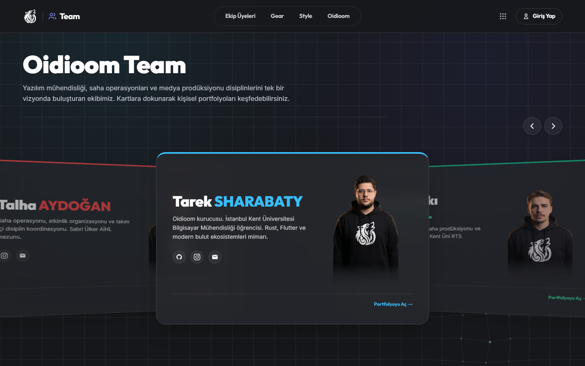

<a href="https://oidioom.com"><picture><source media="(prefers-color-scheme: dark)" srcset=".github/assets/oidioom-dark.svg"></picture></a>

<h1 align="center">Hi, I'm Tarek Sharabaty 👋</h1>

<b>Founder of <a href="https://oidioom.com">Oidioom</a> · Computer Engineering @ İstanbul Kent University</b> 
Rust · Flutter · modern cloud ecosystems

     

<a href="#-english">🇬🇧 English</a> · <a href="#-türkçe">🇹🇷 Türkçe</a>

---

## 🇬🇧 English

I build products under **Oidioom** — from a next-gen PC game launcher to mobile apps and open-source Minecraft mods. This profile is both personal and the home of Oidioom's public projects.

### 🚀 Products

| Project | What it is | Platform |
|---|---|---|
| 🕌 **[Nefs](https://github.com/tariksharabaty/nefs)** | A premium, ad-free Islamic lifestyle & spiritual guidance app. | iOS | Android |
| 🎓 **[Kampüs Asistanı](https://github.com/tariksharabaty/kampus-asistani)** | Your smart campus companion — schedule, attendance and notes in one place. | iOS | Android |
| ✨ **[Neonik](https://github.com/tariksharabaty/neonik)** | Turn your phone into a glowing neon / LED marquee sign. | iOS | Android | Web |
| 💊 **[PharmaGo](https://github.com/tariksharabaty/pharmago)** | Find on-duty pharmacies and healthcare nearby — plus first aid when it matters. | iOS | Android |
| 🔢 **[SayFlow](https://github.com/tariksharabaty/sayflow)** | Smart counters & flow — count anything, track progress, stay focused. | iOS | Android |
| ⚙️ **[Gear](https://github.com/tariksharabaty/gear)** | Next-gen game launcher — all your PC game stores in one fast, local app. | Windows 10 | 11 |
| 🌐 **[oidioom.com](https://github.com/tariksharabaty/oidioom-web)** | The Oidioom ecosystem on the web — one account, many products. | Web |

> Closed-source products are published as **showcase repositories**: overview, screenshots, downloads and short code excerpts.

### ⛏️ Open-Source Minecraft Mods (MIT)

All mods are built on **[O Lib](https://github.com/tariksharabaty/o-lib)** for Fabric and published on **[Modrinth](https://modrinth.com/organization/oidioomstudio)**.

[`📚 O Lib`](https://github.com/tariksharabaty/o-lib) · [`📖 Advanced Enchant`](https://github.com/tariksharabaty/advanced-enchant) · [`🦴 BoneBone`](https://github.com/tariksharabaty/bonebone) · [`🔮 Crystal Wand`](https://github.com/tariksharabaty/crystal-wand) · [`⛏️ Fast Miner`](https://github.com/tariksharabaty/fast-miner) · [`🌲 Fast Tree`](https://github.com/tariksharabaty/fast-tree) · [`🤖 Mega Copper Golems`](https://github.com/tariksharabaty/mega-copper-golems) · [`🪄 Purple Stick`](https://github.com/tariksharabaty/purple-stick) · [`🦅 Slot for Elytra`](https://github.com/tariksharabaty/slot-for-elytra) · [`🗿 Torchmanator`](https://github.com/tariksharabaty/torchmanator) · [`🔦 Invisible Beacon Beam`](https://github.com/tariksharabaty/invisible-beacon-beam) · [`🇹🇷 Turkish Translate`](https://github.com/tariksharabaty/turkish-translate)

### 🛠️ Tech Stack

          

---

## 🇹🇷 Türkçe

**Oidioom** çatısı altında ürünler geliştiriyorum: yeni nesil bir PC oyun başlatıcısından mobil uygulamalara ve açık kaynak Minecraft modlarına kadar. Bu profil hem kişisel hesabım hem de Oidioom'un açık projelerinin evi.

İstanbul Kent Üniversitesi Bilgisayar Mühendisliği öğrencisiyim ve Oidioom'un kurucusuyum.

### 🚀 Ürünler

| Proje | Nedir | Platform |
|---|---|---|
| 🕌 **[Nefs](https://github.com/tariksharabaty/nefs)** | Reklamsız, sade ve premium bir İslami yaşam ve manevi rehberlik uygulaması. | iOS | Android |
| 🎓 **[Kampüs Asistanı](https://github.com/tariksharabaty/kampus-asistani)** | Akıllı kampüs asistanınız — ders programı, devamsızlık ve notlar tek yerde. | iOS | Android |
| ✨ **[Neonik](https://github.com/tariksharabaty/neonik)** | Telefonunuzu parlayan bir neon / LED kayan yazı tabelasına dönüştürün. | iOS | Android | Web |
| 💊 **[PharmaGo](https://github.com/tariksharabaty/pharmago)** | Yakındaki nöbetçi eczaneleri ve sağlık kurumlarını bulun; gerektiğinde ilk yardım elinizin altında. | iOS | Android |
| 🔢 **[SayFlow](https://github.com/tariksharabaty/sayflow)** | Akıllı sayaç ve akış — her şeyi sayın, ilerlemeyi takip edin, odakta kalın. | iOS | Android |
| ⚙️ **[Gear](https://github.com/tariksharabaty/gear)** | Yeni nesil oyun başlatıcı — tüm PC oyun mağazalarınız tek, hızlı ve yerel bir uygulamada. | Windows 10 | 11 |
| 🌐 **[oidioom.com](https://github.com/tariksharabaty/oidioom-web)** | Oidioom ekosisteminin web yüzü — tek hesap, birçok ürün. | Web |

> Kapalı kaynak ürünler **vitrin (showcase) depoları** olarak yayınlanır: tanıtım, ekran görüntüleri, indirmeler ve kısa kod alıntıları.

### ⛏️ Açık Kaynak Minecraft Modları (MIT)

Tüm modlar Fabric için **[O Lib](https://github.com/tariksharabaty/o-lib)** üzerine kuruludur ve **[Modrinth](https://modrinth.com/organization/oidioomstudio)** üzerinde yayınlanır.

[`📚 O Lib`](https://github.com/tariksharabaty/o-lib) · [`📖 Advanced Enchant`](https://github.com/tariksharabaty/advanced-enchant) · [`🦴 BoneBone`](https://github.com/tariksharabaty/bonebone) · [`🔮 Crystal Wand`](https://github.com/tariksharabaty/crystal-wand) · [`⛏️ Fast Miner`](https://github.com/tariksharabaty/fast-miner) · [`🌲 Fast Tree`](https://github.com/tariksharabaty/fast-tree) · [`🤖 Mega Copper Golems`](https://github.com/tariksharabaty/mega-copper-golems) · [`🪄 Purple Stick`](https://github.com/tariksharabaty/purple-stick) · [`🦅 Slot for Elytra`](https://github.com/tariksharabaty/slot-for-elytra) · [`🗿 Torchmanator`](https://github.com/tariksharabaty/torchmanator) · [`🔦 Invisible Beacon Beam`](https://github.com/tariksharabaty/invisible-beacon-beam) · [`🇹🇷 Turkish Translate`](https://github.com/tariksharabaty/turkish-translate)

---

<a href="https://oidioom.com"><picture><source media="(prefers-color-scheme: dark)" srcset=".github/assets/oidioom-dark.svg"></picture></a>

<b>by Oidioom — Tarek Sharabaty</b> 
<a href="https://oidioom.com">oidioom.com</a> · <a href="https://github.com/tariksharabaty">GitHub</a> · <a href="https://modrinth.com/organization/oidioomstudio">Modrinth</a> · <a href="https://gear.oidioom.com">Gear</a> · <a href="https://www.instagram.com/oidioom">Instagram</a>

