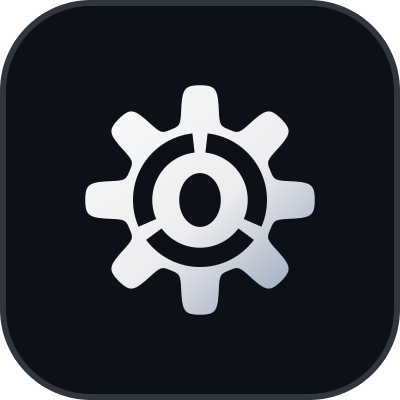
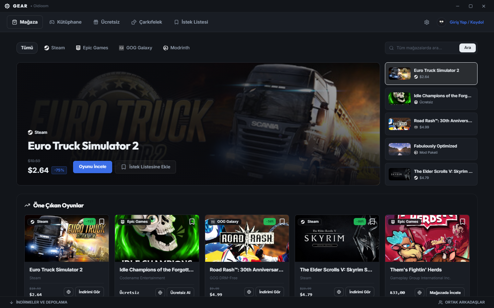

  
  &nbsp;&nbsp;&nbsp;&nbsp;&nbsp;&nbsp;
  

<h1 align="center">Tarek Sharabaty</h1>

Founder of <b>Oidioom</b> · Computer Engineering @ İstanbul Kent University

  
  
  

---

<h3>&nbsp; Gear</h3>

**Next-gen game launcher** — Steam, Epic Games, Xbox, GOG, EA, Ubisoft and more in one fast, local Windows app. 
**Yeni nesil oyun başlatıcı** — tüm PC oyun mağazalarınız tek, hızlı ve yerel bir uygulamada.

  

  <a href="https://gear.oidioom.com"><b>gear.oidioom.com</b></a> · <a href="https://github.com/tariksharabaty/gear">Repository</a>

---

<b>…and much more. &nbsp;·&nbsp; …ve daha fazlası.</b>

